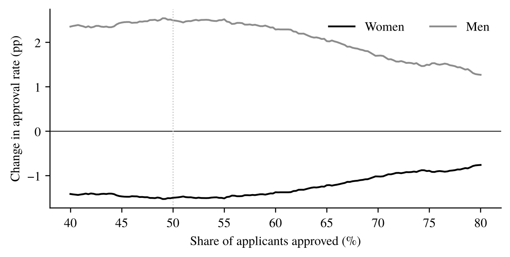
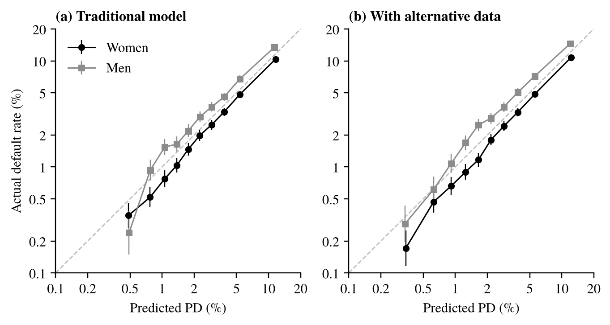
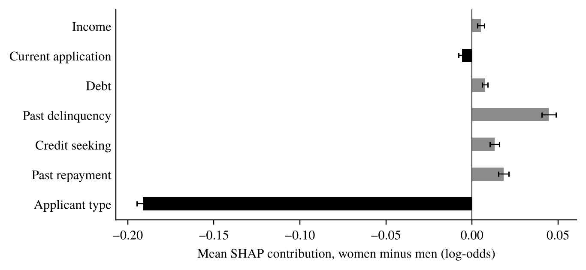
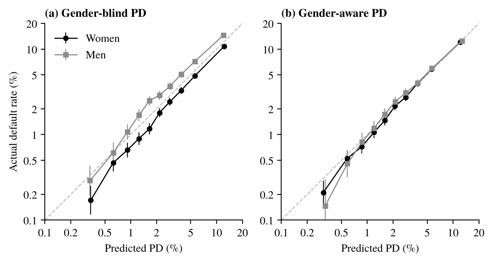
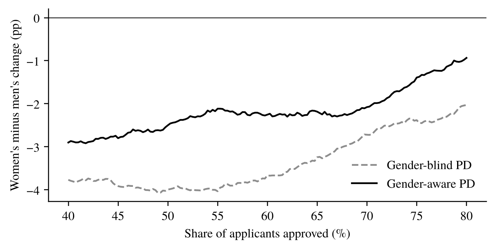

# Blind is not neutral

**Gender bias in a gender-blind credit model**

[**Open the interactive site →**](https://kerry-hao-home-credit.streamlit.app/)

Two LightGBM credit models are trained on 1.53 million Home Credit applications. The traditional model uses application and credit-bureau data; the second model also uses alternative data (tax, deposit and debit-card records). Neither model uses gender. In the final sample of 228,999 applications, women default at 2.63% and men at 3.99%.

## 1. Adding alternative data moves approvals from women to men

At a 50% approval rate, 2,145 approvals move from women to men. Women lose and men gain at every approval rate from 40% to 80%.

## 2. At the same predicted PD, women default less

In a logit of default on the model's log-odds and a female indicator, women's default odds are 0.69 times men's with the traditional model and 0.64 times with alternative data.

## 3. Why: a uniform discount the model cannot learn

The model's scores imply a 10% gap in default odds between women and men; the actual gap is 35%. Tests of the gap's shape, its location across 92 groups and the meaning of each input family all point to a uniform gender discount rather than a mispriced input.

## 4. The fix: use gender only when turning scores into PDs

A gender-aware calibrator, fitted on a separate sample of 114,500 applications and applied once to the final sample, cuts the female coefficient from −0.446 to −0.034 and raises AUC from 0.7787 to 0.7840.

## 5. With the fix, alternative data moves fewer approvals and adds more value

At a 50% approval rate, the approvals that alternative data moves to men fall from 2,145 to 1,343. The value it adds to the lender at a loss-to-gain ratio of 30 rises from 6,064 to 6,866.

## Method

- **Samples:** 1,526,659 applications, split at random into training (1,068,661), tuning (114,499), calibration (114,500) and final evaluation (228,999; 7,199 defaults).
- **Models:** Logit, LightGBM and MLP, each trained with and without alternative data. LightGBM performs best and is used throughout.
- **Lending rules:** fixed approval rate (40%–80%), portfolio risk budget (0.75%–2.00%) and an economic value rule with loss-to-gain ratios from 2 to 50.
- **Statistics:** logit regressions with HC1 standard errors, SHAP decomposition of LightGBM scores, DeLong tests for AUC, paired bootstrap with 1,000 draws, Wilson intervals.

**Data source:** Daniel Herman, Tomas Jelinek, Walter Reade, Maggie Demkin and Addison Howard. Home Credit – Credit Risk Model Stability. https://www.kaggle.com/competitions/home-credit-credit-risk-model-stability, 2024. Kaggle.
